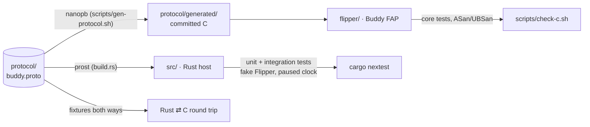
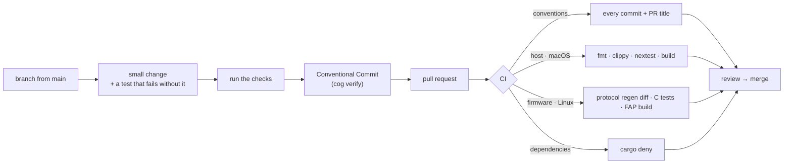

# Contributing to Flipperaki

Thanks for helping. Flipperaki controls a real device on someone's desk, so the bar is simple:
**every change is small, tested without hardware, and honest about what it has not proven.**

- [Set up](#set-up)
- [Find your way around](#find-your-way-around)
- [Run the checks](#run-the-checks)
- [How a change lands](#how-a-change-lands)
- [Changing the Buddy protocol](#changing-the-buddy-protocol)
- [Testing on a real Flipper](#testing-on-a-real-flipper)
- [Ground rules](#ground-rules)

## Set up

| Tool | Why | Install |
| --- | --- | --- |
| Rust 1.100 | host; pinned in `rust-toolchain.toml` | [rustup](https://rustup.rs) picks it up automatically |
| `protoc` | `build.rs` generates the Rust protocol types | `brew install protobuf` |
| `cargo-nextest`, `cargo-deny` | test runner, license/advisory gate | `brew install cargo-nextest cargo-deny` |
| `cog` (cocogitto) | Conventional Commit checks | `brew install cocogitto`, then `cog install-hook --all` |
| `uv` | project-local Python for nanopb and uFBT (in `./.venv`) | `brew install uv` |
| LLVM `clang-tidy`, `cmake` | C tests with sanitizers | `brew install llvm cmake` |

Nothing installs system-wide: the Flipper SDK and toolchain live in `./.ufbt`, Python tools in
`./.venv`, both git-ignored.

## Find your way around

```text
src/                 Rust host — one binary: daemon, mcp, hook and operator commands
├── broker.rs        pure control decisions (who may do what, when) — no I/O
├── daemon.rs        the event loop that owns the device: connection, handoff, Buddy
├── rpc/             bounded native RPC executor (deadlines, multipart, events)
├── transport/       Bluetooth LE (btleplug) and USB serial byte streams
├── device.rs        named device operations (tap, app_start, screen stream, …)
├── mcp.rs · ipc.rs  the six MCP tools and the private socket they talk over
├── hooks.rs         Claude Code hook parsing (allow-listed fields only)
└── limits.rs        every resource bound in one place
flipper/             Buddy, the C app on the Flipper
├── buddy_core.c     portable state machine — host-tested under ASan/UBSan
├── buddy_rpc.c      the firmware RPC boundary
└── flipperaki_app.c · buddy_view.c   device glue and the screen
protocol/            buddy.proto — the one schema both sides are generated from
tests/               host integration tests against a fake Flipper
third_party/btleplug patched fork (see docs/dependencies.md for why and when it goes)
```



Start with [`docs/architecture.md`](docs/architecture.md) and
[`docs/protocol.md`](docs/protocol.md) before changing behavior.

## Run the checks

Run each one on its own so its exit status is unambiguous. CI runs the same commands.

```sh
cargo fmt --all --check
cargo clippy --all-targets --locked -- -D warnings
cargo nextest run --all-targets --locked
cargo test --doc --locked
cargo deny check
scripts/check-c.sh        # Buddy core: -Werror, ASan/UBSan, clang-tidy
scripts/build-fap.sh      # FAP against the pinned Momentum SDK
```

None of these pair, flash or talk to a device. The host tests drive the whole daemon against an
in-memory fake Flipper with tokio's paused clock, so timeouts are instant and deterministic.

## How a change lands



**Commits** follow [Conventional Commits](https://www.conventionalcommits.org): a type
(`feat`, `fix`, `docs`, `test`, `refactor`, `build`, `ci`, `chore`…), an optional scope
(`host`, `flipper`, `rpc`, `ble`, `usb`, `mcp`, `protocol`), and an imperative subject of at
most 72 characters. The body says *why*. Keep formatting churn out of behavioral commits.

```text
fix(host): observe the last redraw instead of demanding a new frame

The firmware sends a screen frame only on redraw; over BLE the redraw
lands before the last input ack, so observations came back empty.
```

**Pull requests** use the template: what changed, why, how it was tested, and — if you touched
behavior a device can show — what you ran on hardware (or that you did not).

## Changing the Buddy protocol

`protocol/buddy.proto` is the single source of truth. Never hand-edit generated code.

1. Edit `buddy.proto` (and `buddy.options` for string bounds). Add fields; never renumber or
   reuse — reserve removed numbers.
2. `scripts/gen-protocol.sh` regenerates the C bindings and checks the largest envelope still
   fits in 512 bytes. Rust regenerates on build.
3. Update the fixtures in `protocol/fixtures/` so both directions still round-trip.
4. Commit the regenerated `protocol/generated/` in the same commit. CI fails if it drifts.

Zero values must never mean "allow": an unset or unknown verdict is a denial on both sides.

## Testing on a real Flipper

Hardware runs are manual and recorded. Follow [`docs/hardware-checklist.md`](docs/hardware-checklist.md)
and add what you observed to [`docs/verification.md`](docs/verification.md): device, firmware,
transport, host commit, FAP hash and the result of each scenario — including what you did *not* run.

Tips that saved hours:

- **Install Buddy over USB** without qFlipper:
  ```sh
  fap=$PWD/flipper/dist/flipperaki.fap
  (cd .ufbt/current/scripts && ../../toolchain/arm64-darwin/bin/python3.11 storage.py \
      -p /dev/cu.usbmodemflip_<name> send "$fap" /ext/apps/Tools/flipperaki.fap)
  ```
- **Read the Flipper's own log while the daemon uses Bluetooth:** keep the USB cable in, open
  the USB serial console and run `log debug`. Buddy logs every message, prompt change and button
  event under the `Flipperaki` tag.
- **Trace the host:** `FLIPPERAKI_LOG=flipperaki=trace flipperaki daemon` shows every Buddy
  message and screen frame.
- The daemon holds the USB port while enrolled for USB; stop it before using qFlipper or the CLI.

## Ground rules

These come from [`AGENTS.md`](AGENTS.md) and apply to people and coding agents alike:

1. The smallest complete, user-visible step. No speculative layers.
2. Reuse maintained libraries; document any fork with its removal condition.
3. Decisions are pure and testable without hardware; side effects sit at named boundaries.
4. Bounds, ownership and cancellation are explicit (`src/limits.rs`).
5. Never turn a missing acknowledgement into success, and never replay a mutation.
6. Physical approval, ASCII consumption, connection epochs and grant revocation are contracts.
7. Test behavior and failure modes, not private call sequences.
8. MCP stdout carries protocol only; logs go to stderr, redacted.
9. Report exactly what was tested, on which device, firmware and platform.

Security issues: please follow [SECURITY.md](SECURITY.md) instead of opening a public issue.

By contributing you agree that your work is licensed under the [AGPL-3.0](LICENSE).
