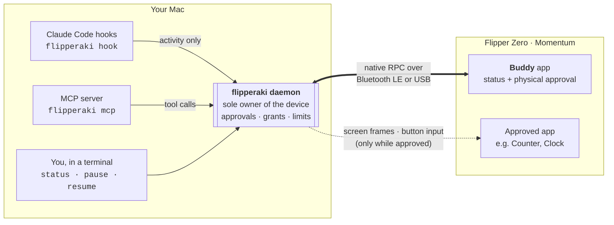
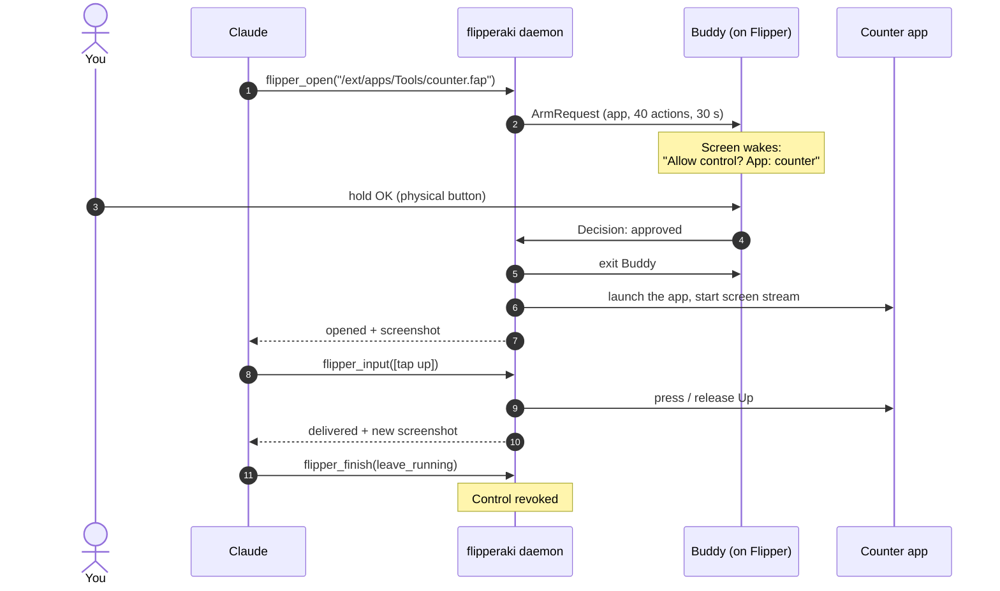

<div align="center">

# Flipperaki

*φλιπεράκι* — a little Flipper that keeps an eye on Claude.

**A Bluetooth-first desk buddy and MCP controller for Flipper Zero.**
See what Claude Code is doing at a glance, and let Claude drive a Flipper app —
only after you approve it with a physical button press.

[](https://github.com/prokolyvakis/flipperaki/actions/workflows/ci.yml)
[](LICENSE)


</div>

> [!NOTE]
> **Release candidate.** Verified on a real Flipper Zero (Momentum `mntm-012`) over **USB and
> Bluetooth**: pairing, physical approval, app handoff, screenshots, button input, pause and
> reconnect. Claude Code driving it end to end has not been run yet. Every claim is backed by a
> recorded run in [`docs/verification.md`](docs/verification.md).

---

## What it does

| | **Buddy** — status on your desk | **Controller** — Claude operates an app |
| --- | --- | --- |
| **You see** | Whether Claude Code is working, needs you, or is done; the project name and session count. | Claude opening an installed app, reading the screen and pressing buttons. |
| **Claude gets** | Nothing — it only reports activity. | Six MCP tools: `status`, `apps`, `open`, `observe`, `input`, `finish`. |
| **You decide** | Hold Back to put Buddy away. | Nothing happens until you **hold OK** on the Flipper. Back denies. |

## How it works

One background **daemon** on your Mac owns the only connection to the Flipper. Everything else —
Claude Code's hooks, the MCP server Claude launches, and your terminal commands — talks to that
daemon over a private socket. On the Flipper, a small app called **Buddy** shows status and asks
for your approval.



## The approval handshake

Claude can never take control on its own. The request waits on the Flipper until a person
physically holds OK; remote, scripted and keyboard input are rejected.



Control ends early — and queued input is dropped — on `flipperaki pause`, a locked Flipper, a
disconnect, the app exiting, the client going away, 5 minutes passing or 40 actions used.
After any reconnect, control starts over: nothing is granted.

## Quick start

**You need:** an Apple Silicon Mac, a Flipper Zero on Momentum firmware
([compatibility](docs/compatibility.md)), and Claude Code. To build from source you also need
[rustup](https://rustup.rs), `protoc` (`brew install protobuf`) and [`uv`](https://docs.astral.sh/uv/).

**1. Build** the Mac app and the Flipper app:

```sh
scripts/package-macos.sh   # → dist/Flipperaki.app (+ dist/SHA256SUMS)
scripts/build-fap.sh       # → flipper/dist/flipperaki.fap
```

Below, `flipperaki` means `dist/Flipperaki.app/Contents/MacOS/flipperaki`.

**2. Install Buddy** — copy `flipperaki.fap` to `/ext/apps/Tools/` on the Flipper (qFlipper or
the SD card).

**3. Choose how to connect:**

```sh
flipperaki scan                                  # lists Flipper Bluetooth ids and USB ports
flipperaki enroll ble --peripheral <id>          # Bluetooth (recommended)
flipperaki enroll usb                            # or the cable
```

The first Bluetooth connection asks you to confirm a passkey on the Flipper.

**4. Start the daemon** and keep it running:

```sh
open dist/Flipperaki.app --args daemon           # macOS asks Flipperaki for Bluetooth access
```

Run `flipperaki daemon` in a terminal instead if you want logs (`FLIPPERAKI_LOG=debug`).
Stop it with `pkill -f "flipperaki daemon"`.

**5. Connect Claude Code:**

```sh
flipperaki install-hooks                         # status on Buddy; backs up ~/.claude/settings.json
claude mcp add flipperaki -- "$PWD/dist/Flipperaki.app/Contents/MacOS/flipperaki" mcp
```

Then ask Claude: *"Open the Counter app on my Flipper, press Up three times and show me the
screen."* Hold OK when the Flipper lights up.

## On the Flipper

| Buddy shows | Press | Result |
| --- | --- | --- |
| Status (`Working`, `Needs you`, `Done`) | **Hold Back** | Puts Buddy away. It stays closed while you use the Flipper and comes back by itself when Claude asks for control. |
| `Allow control? App: …` | **Hold OK** | Approves this one request. |
| `Allow control? App: …` | **Back** | Denies it. Nothing is launched. |
| `Release all buttons` | let go | A button was already held when the request arrived; press again. |

## The MCP tools

| Tool | What it does |
| --- | --- |
| `flipper_status` | Connection, lock state, who holds control, firmware, known limits. |
| `flipper_apps` | Installed apps under `/ext/apps/<category>/`; use an `id` with `flipper_open`. |
| `flipper_open` | Asks you on the Flipper, waits for your decision, launches the app, returns a screenshot. |
| `flipper_observe` | The current screen as a 128×64 image, with how long it has been unchanged. |
| `flipper_input` | Up to three taps or short holds, then a new screenshot. Reports `acknowledged`, `rejected`, `not_sent` or `unknown`. |
| `flipper_finish` | Ends control. The app keeps running; Buddy comes back once you exit it (Flipperaki never presses Back for you). |

`unknown` means the input may or may not have happened; Flipperaki never replays it.

## Your commands

| Command | Use it to |
| --- | --- |
| `flipperaki status` | See the connection, the foreground app and who holds control. |
| `flipperaki pause` | Revoke control immediately and refuse new requests. |
| `flipperaki resume` | Allow requests again (each still needs your approval) and bring Buddy back. |
| `flipperaki scan` / `enroll` | Find and choose the device. |
| `flipperaki install-hooks` / `uninstall-hooks` | Add or remove only Flipperaki's Claude Code hooks. |

## Safety and privacy

- **Physical consent.** Only a real button press counts: Buddy checks each event against the
  button's actual pin, ignores remote and keyboard input, and needs every button released first.
- **Narrow reach.** Six tools, one app at a time, three inputs per call, 40 actions per approval.
  No file access, no arbitrary RPC, no firmware changes.
- **Honest outcomes.** Every input reports whether it was delivered, refused, not sent or unknown.
- **Private by default.** Buddy receives a coarse activity state, a short project name and a
  session count — never prompts, tool arguments, paths or transcripts. Logs stay on your Mac
  and are redacted.
- **One thing does leave your Mac:** screenshots from `flipper_observe`, `flipper_input` and
  `flipper_open` go to Claude, like any tool result.

The full threat model is in [SECURITY.md](SECURITY.md).

## Documentation

| Read | To learn |
| --- | --- |
| [Architecture](docs/architecture.md) | Components, the control state machine, connection lifecycle, honest limits. |
| [Buddy protocol](docs/protocol.md) | The message schema shared by the Rust host and the C app. |
| [Compatibility](docs/compatibility.md) | Firmware and SDK pins, and the firmware facts the app relies on. |
| [Hardware checklist](docs/hardware-checklist.md) | The ten scenarios a release must pass on a real device. |
| [Verification record](docs/verification.md) | What was actually run, on which device, with what result. |
| [Implementation status](docs/implementation-status.md) | Progress, accepted deviations and known limitations. |
| [Dependencies](docs/dependencies.md) | Third-party code, including the patched `btleplug`. |
| [Contributing](CONTRIBUTING.md) | Setting up, the checks, and how changes land. |

## Uninstall

```sh
flipperaki uninstall-hooks
claude mcp remove flipperaki
rm -rf ~/Library/Application\ Support/flipperaki
```

Delete `/ext/apps/Tools/flipperaki.fap` from the Flipper and forget it in macOS Bluetooth
settings.

## License

[AGPL-3.0](LICENSE). Third-party notices: [docs/dependencies.md](docs/dependencies.md).
