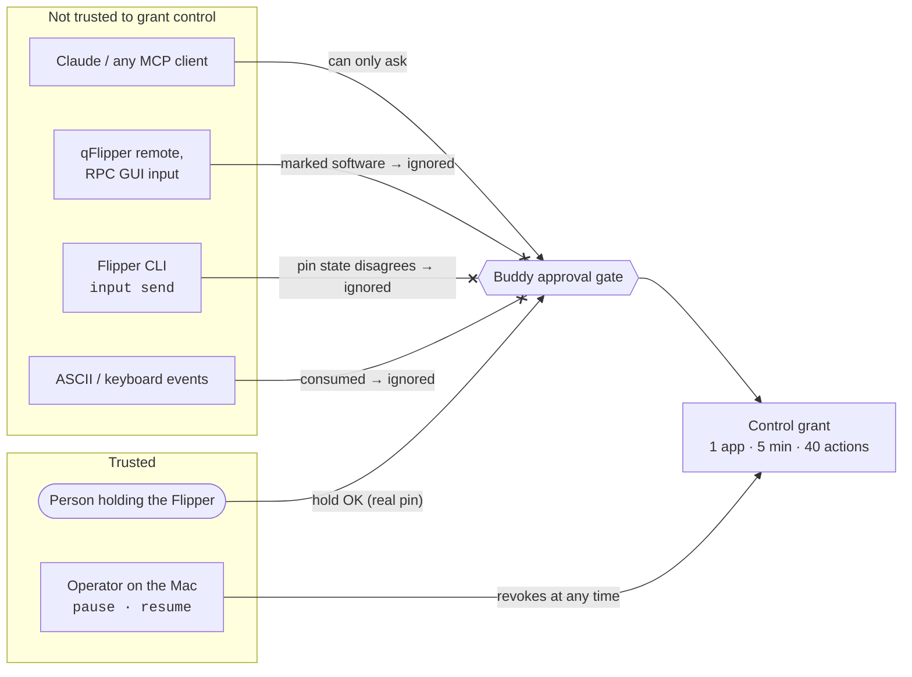

# Security

Flipperaki lets an AI agent press buttons on a radio device on your desk. Its security rests on
one promise: **nothing is controlled without a fresh, physical "yes" from the person holding the
Flipper** — and that yes covers one app, for a short time, with a small budget.

## Reporting a vulnerability

Please report privately through GitHub's
[private vulnerability reporting](https://github.com/prokolyvakis/flipperaki/security/advisories/new)
rather than in a public issue. Include the firmware version, transport (BLE or USB), host
commit and the steps to reproduce.

Only the latest commit on `main` is supported.

## Threat model

### What is protected, and how

| Threat | Mitigation |
| --- | --- |
| The agent approves its own request | Approval exists only on the Flipper. The MCP tools can ask (`flipper_open`) but have no approve path. |
| Injected input fakes the approval (qFlipper remote, RPC GUI input) | Buddy accepts only hardware-origin input events; software-origin events are ignored. |
| CLI `input send` (which looks like hardware) | Every event must agree with the button's real GPIO pin: down for press/long, up for release/short. |
| Keyboard / ASCII events | Buddy consumes them so the firmware never turns them into button presses. |
| A button already held when the prompt appears | All buttons must be released before a gesture counts. |
| Approving the wrong app | The prompt shows the exact app name and category; the host may only launch `/ext/apps/<category>/<name>.fap` whose name matches. |
| A stale or replayed decision | Decisions bind to the request id and the connection epoch; anything else is refused and the prompt withdrawn. |
| Control outliving the operator's intent | Grants expire (5 min, 40 actions) and are revoked by `pause`, lock, disconnect, app exit, client exit and transport change. A reconnect never restores a grant. |
| Duplicate or phantom input | Delivery is reported as `acknowledged`, `rejected`, `not_sent` or `unknown`; mutations are never retried. |
| Resource exhaustion | Frames, replies, queues, IPC lines and hook input all have hard bounds (`src/limits.rs`). |
| Leaking prompts or code to the Flipper | Hooks forward an allow-listed activity state, project basename and session count only. |

### Out of scope

- **Other processes running as you.** The daemon's socket is private to your user (`0700`
  directory, `0600` socket); anything already running as your user can reach it. The physical
  approval is the protection, not a sandbox.
- **What an approved app does.** Input goes to the Flipper's global input bus; Flipperaki checks
  that an app still holds the loader but cannot prove which app is in front.
- **Screenshots.** While control is granted, screen images go to the Claude service as tool results.
- **A compromised Flipper or firmware**, and anyone with physical access to it.

## Supply chain

Dependencies are pinned in `Cargo.lock` and checked by `cargo deny` (licenses, advisories,
crates.io only). The single fork, `third_party/btleplug`, carries a two-hunk patch documented in
[`third_party/btleplug/PATCHES.md`](third_party/btleplug/PATCHES.md). The Flipper SDK archive is
pinned by SHA-256 in `scripts/build-fap.sh`. CI actions are pinned to commit SHAs.
