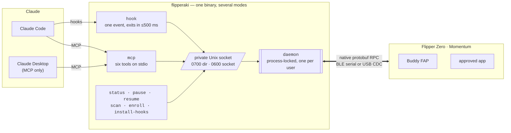
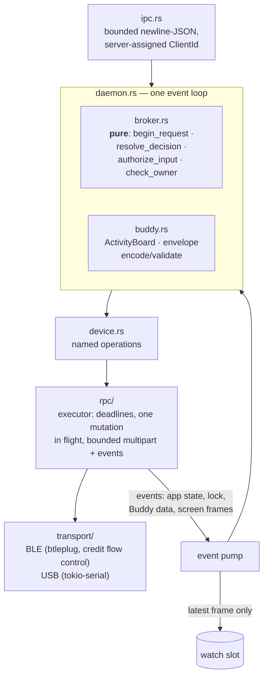
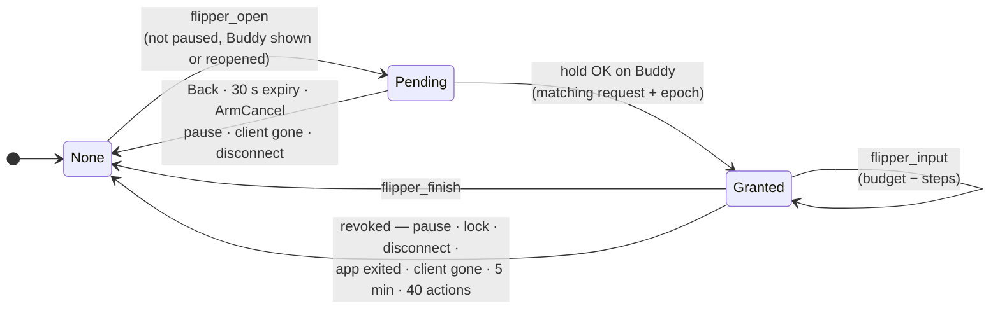
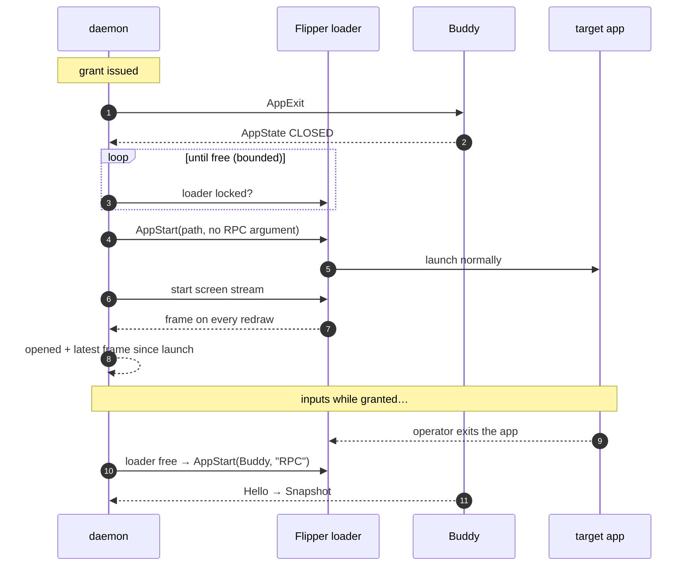
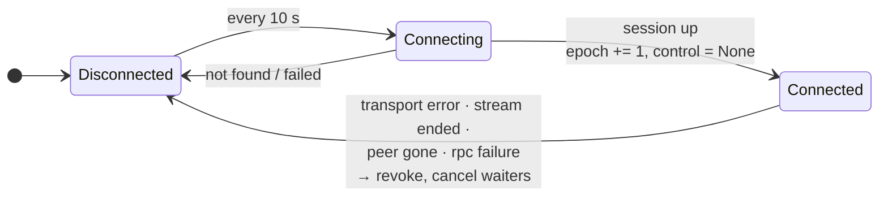
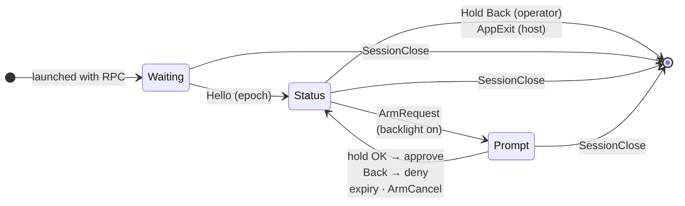

# Architecture

Flipperaki is one Rust binary on the Mac and one C app (Buddy) on the Flipper, sharing one
protocol schema. This page explains how the pieces fit, how control is granted and taken away,
and what the design deliberately does not promise.

- [The pieces](#the-pieces)
- [Inside the daemon](#inside-the-daemon)
- [Control: who may press buttons, and when](#control-who-may-press-buttons-and-when)
- [Handing the screen from Buddy to an app](#handing-the-screen-from-buddy-to-an-app)
- [Connections and epochs](#connections-and-epochs)
- [Buddy on the Flipper](#buddy-on-the-flipper)
- [Honest boundaries](#honest-boundaries)

## The pieces

| Mode | Role |
| --- | --- |
| `daemon` | Owns the single device connection, Buddy state and control grants. A lock file prevents a second owner. |
| `mcp` | Thin stdio MCP server forwarding to the daemon. stdout carries MCP messages only. |
| `hook` | Reads one Claude Code hook payload (allow-listed fields), forwards the activity, prints nothing and always exits 0 within 500 ms. |
| operator commands | `status`, `pause`, `resume`, `scan`, `enroll`, `install-hooks`, `uninstall-hooks`. |

The daemon is the only process that touches the Flipper. Clients never share a connection, and
the daemon assigns every client its identity — a client cannot claim to be another.

## Inside the daemon

Decisions are pure functions; the daemon loop performs the side effects they call for.

| Path | Responsibility |
| --- | --- |
| `src/limits.rs` | Every resource bound, in one file. |
| `src/broker.rs` | Pure control decisions — testable without a device or a clock. |
| `src/daemon.rs` | Connection lifecycle, epochs, handoff, Buddy traffic. |
| `src/buddy.rs` | Buddy envelope encode/validate; aggregation of Claude activity. |
| `src/hooks.rs` | Allow-listed hook parsing → activity report. |
| `src/ipc.rs`, `src/mcp.rs` | The socket protocol and the six tools. |
| `src/setup.rs`, `src/config.rs` | Reversible Claude settings merge; enrolled device. |
| `src/rpc/`, `src/device.rs` | Native RPC executor and the operations built on it. |
| `src/transport/` | Byte streams over Bluetooth LE and USB. |
| `flipper/` | Buddy: portable core, nanopb boundary, RPC adapter, view. |

## Control: who may press buttons, and when

There is at most one pending request or one grant at any time.

1. `flipper_open(app)` creates one **pending request** (client, epoch, app, 30 s) and sends an
   `ArmRequest` to Buddy, which wakes the screen.
2. The operator holds OK. Only a fresh, hardware-origin gesture counts (see [SECURITY.md](../SECURITY.md)).
3. Buddy's `Decision` is checked against the request id, epoch and expiry, and becomes a
   **grant**: one app, 5 minutes, 40 actions. Anything else is refused and the prompt withdrawn.
4. `flipper_input` (≤ 3 steps, holds ≤ 1.5 s) is authorized against the grant *before* a byte
   is sent; the budget is spent first, so a failure never refunds it.
5. Each input reports delivery separately from the observation:
   `acknowledged` · `rejected` · `not_sent` · `unknown`. Nothing is ever replayed.

## Handing the screen from Buddy to an app

- Targets are launched **without** the RPC argument, exactly as from the menu.
- Screenshots are the latest redraw since the app started; the Flipper sends a frame only when
  the screen changes, so `age_ms` is how long it has looked this way.
- `flipper_finish` never presses Back for the app. With `return_to_buddy` and the app still open,
  it reports `not_sent` and asks the operator to exit; Buddy returns as soon as the loader is free.
- If the operator **quits Buddy** (Hold Back), it stays closed until a request needs a prompt,
  `flipperaki resume`, or a new connection.

## Connections and epochs

Every successful connection gets a new **epoch**. Buddy messages, requests and grants carry it,
so nothing from an earlier connection can be acted on after a reconnect.

On BLE the Flipper announces how many bytes it can accept (flow-control credit); writes never
exceed it, and lost notifications end the stream instead of silently dropping bytes (the reason
for the patched `btleplug`, see [dependencies](dependencies.md)).

## Buddy on the Flipper

The core (`flipper/buddy_core.c`) is a portable state machine with no firmware calls; it is
tested on the host under ASan/UBSan. Decoding always fills a fresh value and validates it before
anything live changes, so a malformed message can never half-replace a prompt.

## Honest boundaries

- GUI input goes to the Flipper's global input bus. The loader lock says *an* app is running,
  not *which*; the daemon re-checks it before every input but cannot detect every manual change.
- An RPC acknowledgement means the event was published, not that the app reached a goal.
- `pause` stops future actions; it cannot stop an operation already running inside an app.
- Screenshots returned through MCP are sent to the Claude service.
- Processes running as the same user can reach the socket; physical approval and the narrow tool
  set are the protection, not a sandbox.
- Hooks report Claude Code activity only; Claude Desktop chat activity is not visible.
