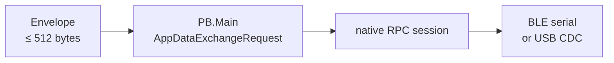
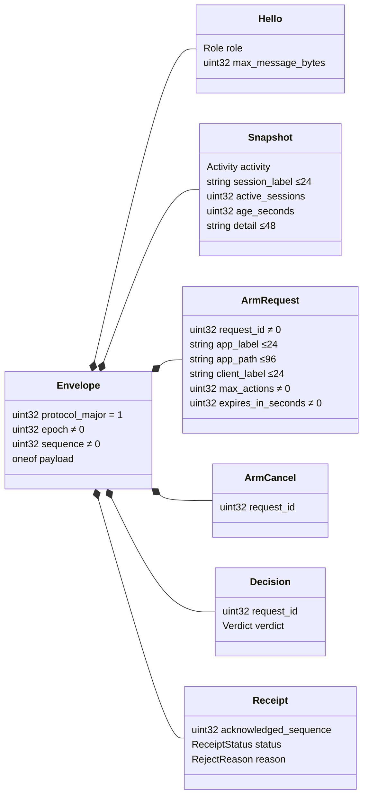
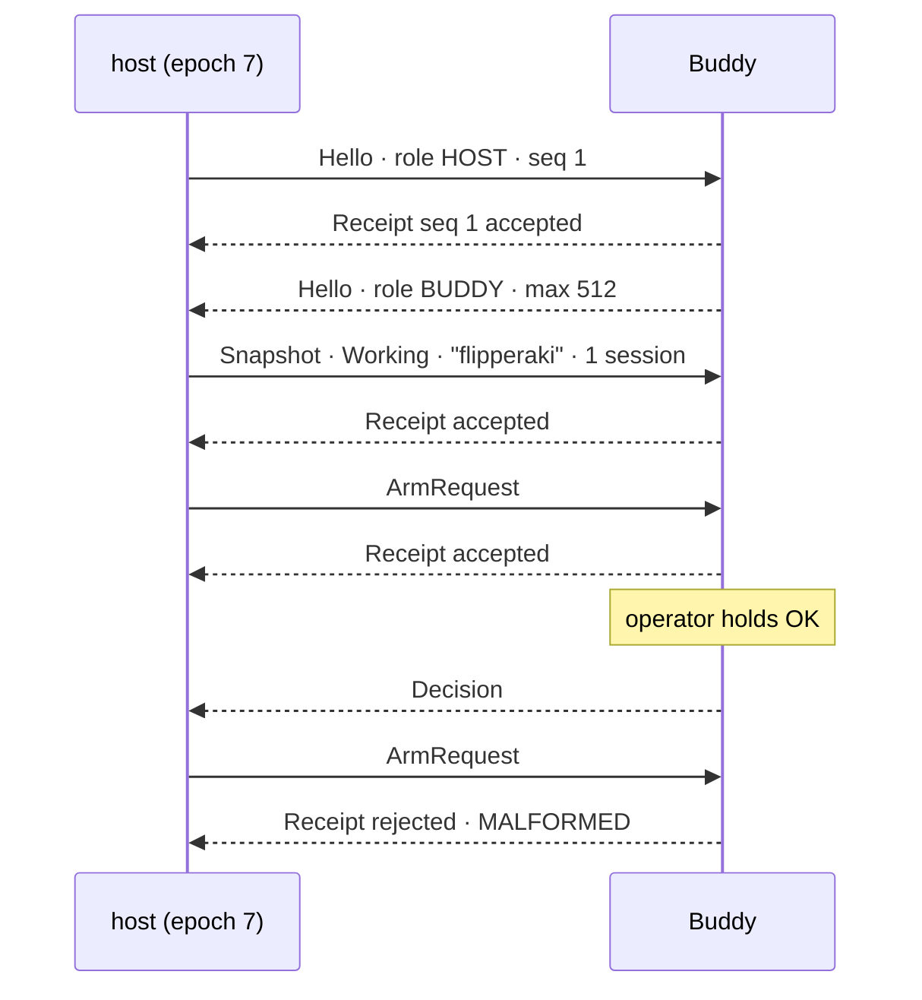

# Buddy protocol

The host and Buddy talk in small protobuf messages called **envelopes**. There is one schema,
[`protocol/buddy.proto`](../protocol/buddy.proto); both sides are generated from it:

| Side | Generator | Where |
| --- | --- | --- |
| Rust host | prost, at build time (`build.rs`) | `OUT_DIR` |
| C app | nanopb 0.4.8 (`scripts/gen-protocol.sh`) | `protocol/generated/`, committed; CI fails on drift |

Fixtures in `protocol/fixtures/` are encoded by each side and decoded by the other, so the two
can never silently disagree.

## Transport

Envelopes ride inside the Flipper's own RPC as the payload of `AppDataExchangeRequest` — no
extra framing, checksum or fragmentation. The firmware delivers them to Buddy only while Buddy
was launched by the host with the `RPC` argument.

## The envelope

| Message | Direction | Meaning |
| --- | --- | --- |
| `Hello` | both | Role and the largest message each side accepts. The host's Hello sets the epoch. |
| `Snapshot` | host → Buddy | The complete status to display. Replaces the previous one; may be coalesced. |
| `ArmRequest` | host → Buddy | Ask the operator to approve one app. Its `request_id` never changes meaning. |
| `ArmCancel` | host → Buddy | Withdraw the pending request. |
| `Decision` | Buddy → host | The operator's physical approve or deny for `request_id`. |
| `Receipt` | Buddy → host | Buddy accepted or rejected a message, and why. (Buddy also understands a host receipt for its `Decision`, but the host does not send one yet, so Buddy shows a denial as "unconfirmed".) |

## A conversation

## Rules both sides enforce

| Rule | Value |
| --- | --- |
| Size | an encoded envelope is at most 512 bytes (largest possible today: 189) |
| Version | `protocol_major` must be 1; anything else → `VERSION` |
| Epoch | nonzero and equal to the current connection's; otherwise → `EPOCH` |
| Sequence | nonzero, chosen by the sender |
| Zero values | never authorize: `VERDICT_UNSPECIFIED` and unknown verdicts are denials |
| Text | printable ASCII within its bound; too long is **rejected, never truncated** — a permission prompt must show exactly what will run |
| App identity | `app_path` must be `/ext/apps/<category>/<name>.fap` with `name == app_label` |
| Decoding | into a fresh value, validated before anything live changes |
| Compatibility | add fields only; removed field numbers are reserved |

## Changing the schema

See [Changing the Buddy protocol](../CONTRIBUTING.md#changing-the-buddy-protocol).
